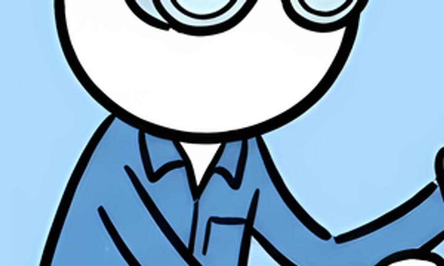
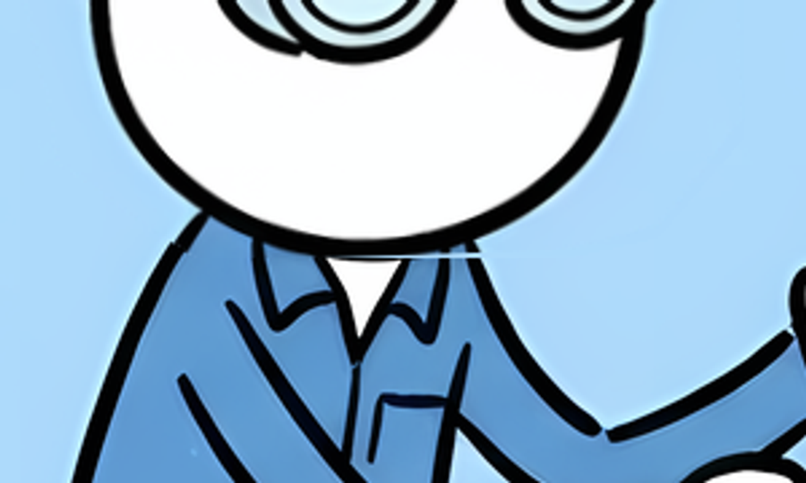
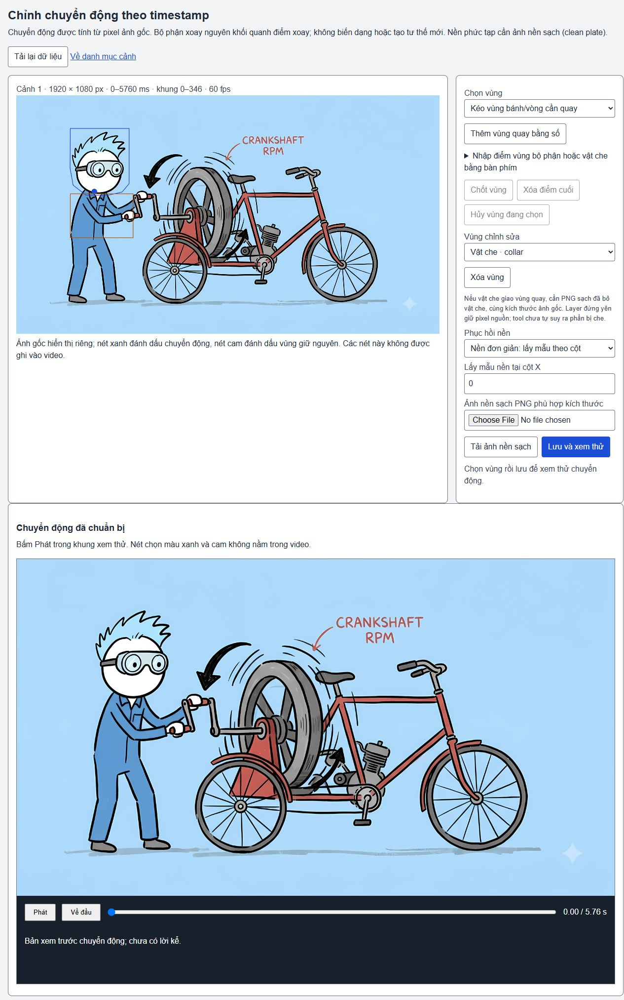
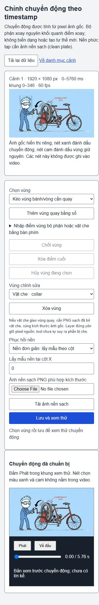

# Chuyển động ảnh: vật che và bề mặt quay sạch

Bản triển khai kế tiếp f96541b trên nhánh codex/prehistoric-life. Tiến độ chức năng toàn dự án ước lượng **49%**. Đây không phải tỷ lệ nghiệm thu hình hoặc full video; mục tiêu đầy đủ còn active. Nguồn Flow Doodle 24 ảnh và clock được giữ nguyên. Chặng này chỉ chuẩn bị/chạy clip riêng, chưa nối lại narration.

## Đã triển khai

- Definition version1 thêm occlusions tùy chọn: polygon nguồn đứng yên, đặt trên các layer chuyển động. Lớp cổ áo được loại khỏi alpha đầu/tay trước khi xoay, rồi giữ màu nguồn ở phía trước.
- Nếu vật che giao bánh quay, cần rotationSource:clean-plate và PNG sạch phù hợp kích thước, hash và độ đục. Không xoay cả mảng khung xe rồi chỉ phủ thêm khung lên trên. API thiếu/không khớp ảnh sạch trả HTTP422 NEEDS_MOTION_SOURCE; giữ recipe cũ để có thể tải lại và resume.
- Preparer timestamp-parts-2 lưu artifact mới, không ghi đè manifest v1. Legacy definition không tự thêm trường/default và mask cũ giữ byte. Góc/chu kỳ đổi vẫn dùng cutout cache; static cache có version riêng sau khi sửa lỗi phụ thuộc nhầm vào moving alpha.
- Clip đã có được xác minh đầy đủ theo source/clock/visual/asset/HTML/MP4/receipt. Thay metadata phiên bản hoặc đường dẫn chuẩn bị không phải lý do render lại.
- Editor có mode Giữ vật che đứng yên, polygon bằng chuột hoặc số, nét cam riêng; vùng này không có góc/điểm xoay. Nét xanh/cam không vào MP4. Không thêm chú thích vào cảnh; chữ đã có trong nguồn vẫn giữ.

## Bằng chứng local

| Kiểm tra | Kết quả | Giới hạn |
|---|---|---|
| Build core + Studio + Vite | PASS | Không thay nghiệm thu runtime toàn sản phẩm |
| Typecheck 8 file test liên quan và toàn test đã tracked trong snapshot source commit | PASS | Working checkout có file native-support-gait-continuity chưa tracked còn lỗi cũ; runtime toàn test không được chạy |
| 28 test image motion/timestamp | PASS | Sau sửa mapping API, 2 ca workbench chạy lại và PASS; receipt worker trong test không phải video thật |
| Synthetic wheel + red foreground | PASS: màu nguồn đứng yên, không kéo màu khung vào bề mặt quay, seek lặp lại | Kiểm tra painter cố định trong Chrome; không nghiệm thu bánh thực của ảnh0001 |
| Clip0001 thật | H.264 1920×1080, 60/1 fps, 346 frame, 5.766667s, decodeErrors0, seek PNG exact, browserErrors[] | Draft im lặng; end clock5760ms sai số+6.667ms |
| Painter0001 | đầu/giữa/cuối và seek kiểm tra RGBA: nguồn ở0 và5760ms exact; vùng cổ áo bên trong0 pixel đổi; ngoài ROI đầu0 pixel đổi | Không phải pixel MP4 nén; chưa xác nhận diễn hoạt tự nhiên |
| Nâng preparer v1→v2 | 4 clip1/2/6/13 giữ nguyên thư mục cache | Sau thêm mask cổ, chỉ render lại1 |
| Sau sửa1 và restart | 2/6/13 giữ nguyên SHA256 MP4; 4 clip còn truy cập được | Xem cache-audit.json |
| HTTP thật | 422 NEEDS_MOTION_SOURCE, revision không đổi khi từ chối; MP4 Range206/32bytes | Mất file sạch cũng trả422 NEEDS_MOTION_SOURCE qua HTTP thật; không tự tạo ảnh sạch |
| UI1280/375 | Tải nguồn, chọn Vật che · collar, thông số xoay ẩn, không tràn ngang, có preview | Mouse click Phát không đổi trạng thái do browser thử cũ còn kẹt; chọn vùng/save/play/download toàn luồng chưa PASS |

Source code trong snapshot index74b2f8597d063a71f43e7a4cfb9652ccb2746bf0 đã build và npm run test:typecheck độc lập với các thay đổi narration/art chưa stage. Chỉ bổ sung bằng chứng/MD sau bước đó; code được đối chiếu byte trước commit.

Lệnh kiểm tra:

~~~powershell
npm run build
node --experimental-test-module-mocks --import tsx --test --test-concurrency=1 tests/image-motion.test.ts tests/image-motion-editor.test.ts tests/image-motion-character.test.ts tests/image-motion-arms-api.test.ts tests/image-motion-timestamp.test.ts tests/image-timestamp-workbench.test.ts tests/image-timestamp-definition.test.ts tests/image-timestamp-foreground.test.ts
~~~

Source-only review qua9router: coder đề xuất preparer; orchestrator kiểm tra/sửa trước apply. Tester gpt-6-luna nêu grayscale raw channels; phép tái hiện với Sharp đang cài cho thấy PNG metadata1 channel nhưng ensureAlpha().raw() ra4 channel, nên không áp thay đổi không chứng minh được. Hai call dùng tổng20892 token gateway; render không gọi model/TTS. Review không thay runtime/visual acceptance.

## Chưa đạt và bước tiếp

1. Mép cổ clip0001 vẫn có đường nối khi soi gần; giữ cổ áo đúng pixel đã đạt, độ đẹp/tự nhiên chưa đạt. Không dùng mẹo giữ nguyên một phần mặt để che lỗi. Cần chọn mép/overlap và nền phục hồi phù hợp, rồi người dùng xem clip.
2. Bánh ảnh0001 bị khung đỏ che vẫn thiếu PNG bề mặt bánh sạch. Chỉ có synthetic proof cho cơ chế mới. Không tuyên bố tự suy ra phần bị che hoặc quay bánh thực ảnh0001 đúng.
3. Cử động hiện là xoay nguyên mảng pixel quanh pivot, không tạo pose mới, đi/chạy, head turn hoặc lip-sync. Clip0006 có đầu/tay nhưng vai/mép bảng cần duyệt. 20 ảnh còn lại chưa có recipe chuyển động.
4. Hoàn tất UI chọn vùng→save→preview→render→download sau khi tab thử browser cũ hết kẹt; không sử dụng renderer Puppeteer để giả test UI.
5. Sau khi từng ảnh được duyệt: bàn giao manifest clip, ghép đúng clock/gap/giọng, review/repair và final/QC. Ba luồng input, ngoại ngữ, TTS ngoài/local và actor casting vẫn trong mục tiêu chung; source narration đang dở giữ riêng, không có trong commit này.

## Artifact tại máy này

Server riêng đang chạy http://127.0.0.1:8860/, editor1 /api/image-timestamp/edit/1. Hướng dẫn khởi động ở docs/topics/IMAGE-TIMESTAMP-MOTION.md. Cổng8850/8858 và project cũ giữ riêng.

Clip mới: runtime/image-motion/timestamp-workbench/studio/attempts/7d740b5b-31b6-4f1a-b46b-10cdf0c9b65b/1/clip-0001-66cf793c79633563/demo.mp4. Runtime/MP4 không upload GitHub. Recipe tái sử dụng: docs/topics/motion-recipes/flow-doodle-0001-head-editor.json; metadata/layer/clock/hash trong motion/timing/QC local. productionReady:false, qualityAccepted:false.

[QC clip thật](actual-clip-qc.json), [pixel audit](actual-pixel-audit.json), [HTTP](http-smoke.json), [cache](cache-audit.json), [migration](migration-api.json), [review resolution](review-resolution.json).

Ảnh dưới là pixel painter source/mid, không phải bằng chứng đã duyệt mép nối:

