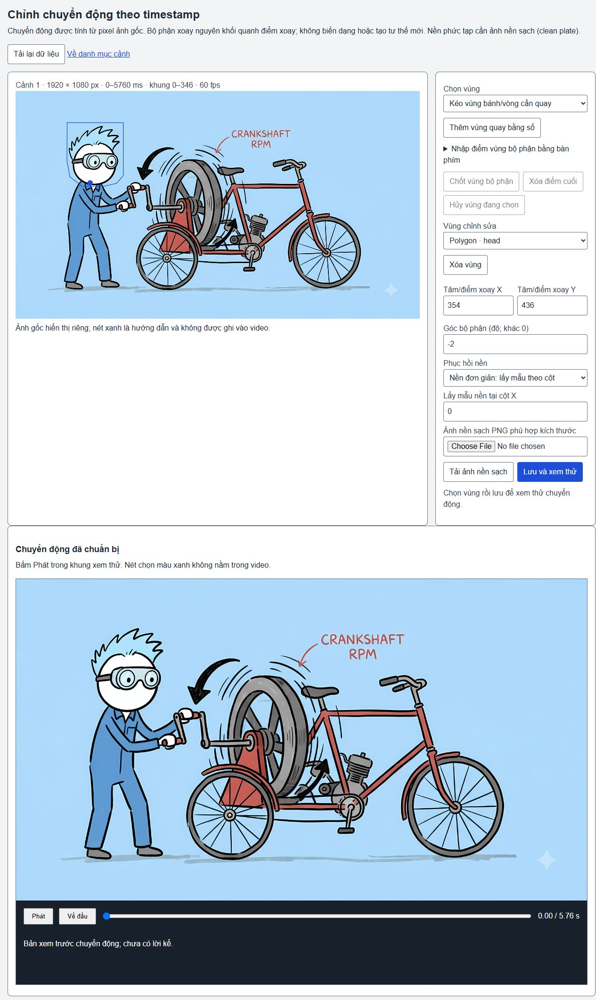
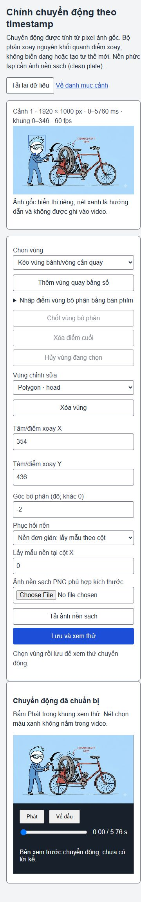

# Kiểm chứng editor ảnh → clip theo timestamp

Ngày local: 12/10/2026. Trạng thái: **đã có code và kiểm chứng API/render; chưa nghiệm thu UI toàn luồng hoặc chất lượng diễn hoạt**. Tiến độ dự án ước lượng 48% về chức năng, không phải tỷ lệ đạt chất lượng hình. Mục tiêu story/script/WAV → video final có giọng vẫn chưa hoàn thành.

## Kết quả có bằng chứng

- Schema đóng cho ellipse và polygon/pivot; không nhận HTML/JS để thực thi. Clock chỉ lấy từ Flow export. Source export được giữ chỉ đọc. File nguồn 24 cảnh có time cuối 129260 ms và hai gaps giữ nguyên.
- API lưu definition/chuẩn bị layer, PNG nền sạch, preview fixed painter và ledger resume. Đổi góc giữ pixel layer cache; cache clip đối chiếu từng cảnh thay vì mất hiệu lực vì revision của cảnh khác. PNG hỏng trả422; receipt/source/dimensions/asset hashes được kiểm tra trước khi lưu.
- Test gián đoạn chuẩn bị đã bắt được EEXIST; sửa bằng attempt riêng, giữ output cũ và dùng lại layer cache. Không xóa thư mục nguồn hay artifact cũ.
- Regression 25/25 PASS, API/schema 4/4 PASS sau sửa cuối; build và typecheck phạm vi scripts/tests PASS. Không tuyên bố toàn bộ test repo PASS: test native-support-gait-continuity cũ ngoài phạm vi có lỗi typecheck đã biết. Các fixture worker trong testAPI là dữ liệu giả, không phải video QC.
- Clip 0001 thật: 1920×1080 H.264,60/1 fps,346 frame,5.766667s. Clock nguồn0–5760ms, startFrame0/endFrame346; sai số cuối+6.667ms. Decode 0 error, seek PNG exact, browserErrors [].
- Mẫu 0001 chỉ cử động đầu−2° từ pixel nguồn. RGBA frame đầu/cuối bằng ảnh gốc. Frame giữa thay 55.805 pixel, bounds 234/144–511/453,0 pixel đổi ngoài ROI đầu 230/130–550/470. Chữ có sẵn và bánh xe giữ nguyên. Xem pixel-audit.json và actual-clip-qc.json.
- 0002 / 0006 / 0013 giữ cùng thư mục và hash MP4 sau sửa0001; không render lại. Sau restart, prepare lại đúng definition trả200, revision giữ nguyên và cả 4 clip vẫn có cache. GET preview 200, MP4 Range 206 đúng 32 byte. Xem cache-audit.json và http-smoke.json.
- UI đã quan sát tảiảnh/clock/definition, nhập góc 0 chặn Save, responsive 1280 / 800 / 375 không tràn ngang. Preview không tự phát và có nút Phát; vùng chọn xanh không nằm trong clip. Bản mới dùng lựa chọn bỏ/giữ trong trang, bỏ confirm/beforeunload của browser.

## Điều chưa được xác minh hoặc chưa đạt

- Chuỗi click chọn vùng → Save → Play → quay lại danh mục → render → download chưa kiểm thử trọn vẹn trong UI. Tab thử cũ trong in-app browser bị kẹt khi bỏ bản nháp; thao tác mouse/key không làm thay đổi trang, dù read/field input/API vẫn chạy. Đã nhờ người dùng đóng tab/hộp thoại thử 8860; chưa có xác nhận. Không coi đây là UI PASS. API/runtime có thể tiếp tục độc lập.
- Mẫu 0001 còn mép nối cổ khi đầu quay. Mẫu 0006 còn mép nối vai/bảng. Chưa duyệt khả năng diễn xuất tự nhiên. Không có face turn/phoneme lip-sync, hành động toàn thân hay pose mới từ một ảnh.
- Ellipse xoay cả pixel của vùng. Cảnh0001 thử bánh bị khung xe che đã kéo mảngkhung xe theo; không dùng mẫu đó làm kết quả tốt. Cần mask/layer che phía trước. Bánh quay mẫu 0002 là asset đã tách riêng. Nền phức tạp vẫn cần người dùng cung cấp clean plate, không tự inpaint.
- Mới4 clip local (1 đầu, 2 bánh, 6 đầu/tay, 13 bánh răng);20 cảnh còn cần chuyển động phù hợp. Import 24 cảnh không có nghĩa 24 cảnh đã chuyển động.
- Các MP4 đều im lặng, productionReady:false, qualityAccepted:false. Chưa ghép toàn timeline/gaps/audio/subtitles hoặc đóng final QC. Công việc narration đang dở được giữ riêng.

## Chạy và kiểm thử tiếp

Server tại http://127.0.0.1:8860/ đang chạy từ worktree C:/Users/Duongvh-pc/.codex/worktrees/stickman-acting-v22/Story-2-video-factory2.1. Nếu đã chạy chỉ mở trang, không khởi động trùng. Không đổi checkout D hoặc server 8850. Cổng 8858 cũ chưa chạy lại trong chặng này. Hướng dẫn khởi động, source path, FFmpeg/Chrome và bindings nằm trong docs/topics/IMAGE-TIMESTAMP-MOTION.md. Checkout mới có thể dùng docs/topics/motion-recipes/empty-timestamp-bindings.json và output mới, rồi chuẩn bị từng cảnh trong editor.

```powershell
node --experimental-test-module-mocks --import tsx --test --test-concurrency=1 tests/image-motion.test.ts tests/image-motion-editor.test.ts tests/image-motion-character.test.ts tests/image-motion-arms-api.test.ts tests/image-motion-timestamp.test.ts tests/image-timestamp-workbench.test.ts tests/image-timestamp-definition.test.ts
npm run build
```

Môi trường đã dùng: Windows, Node 24.19, TSNodeNext/tsx, Sharp, Chrome-headless 154, FFmpeg/ffprobe C:/ffmpeg/bin. Render không gọi model/TTS. coder 9router đề xuất editor (10.404 token); tester 9router review source một lượt (10.809 token). Đề xuất được kiểm tra trước khi áp dụng; source review không phải nghiệm thu art/runtime.

Test tiếp trong browser sau khi đóng tab thử cũ: chuẩn bị một ảnh không có recipe, thử ellipse không bị che và polygon có pivot; nhập sai/ngoài ảnh, chốt/undo/cancel, đổi góc rồi Save, Reload giữ dữ liệu, Play/seek, xuất/tảiMP4, đổi một cảnh giữ cache cảnh khác. Thử PNG nền sai kích thước/hỏng/không khớp source, source đổi và concurrent render/save phải bị chặn. Sau đó duyệt mép tách/tiếp xúc/nhịp chuyển động trước khi làm20 cảnh và nối voice.

## Artifact local

Clip 0001 cuối: C:/Users/Duongvh-pc/.codex/worktrees/stickman-acting-v22/Story-2-video-factory2.1/runtime/image-motion/timestamp-workbench/studio/attempts/8ec0f002-99bb-4d9d-8f23-57d04b749e69/1/clip-0001-80942805447d9f76/demo.mp4
Source hash 0001:17fc0416ce28169f035707ceb49789d7b77710de596460d9befd2471c3d8f8b6. MP4/layer/cache/log runtime không có trong Git; JSONQC, audit và screenshot dưới thư mục báo cáo là bằng chứng được bàn giao. Clip thử bánh lỗi ở attempt 302755ac được giữ chẩn đoán, không phải final.





SOURCE-HASHES.json ghi hashcode bàn giao. Commit/remote sẽ được đối chiếu Git và rawGitHub sau khi push.
