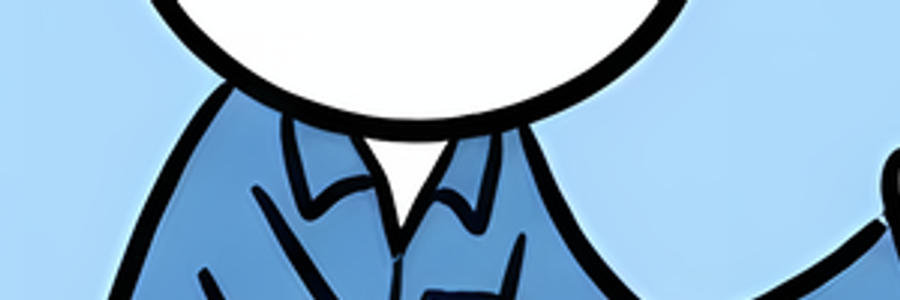
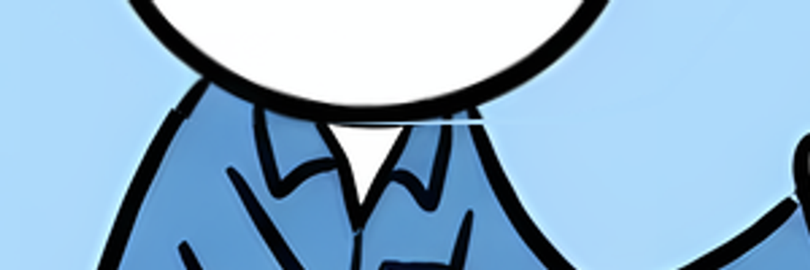
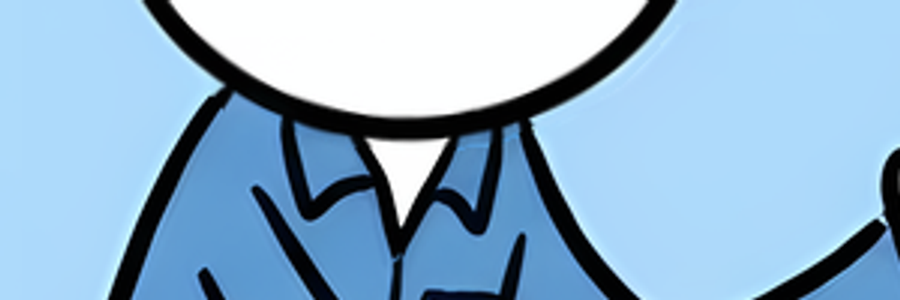

# Pixel nguồn và mép nối cổ khi tạo clip60fps

Bản kế tiếp5309221, nhánh codex/prehistoric-life. Tiến độ chức năng toàn dự án ước lượng **50%**, chưa phải tỷ lệ nghiệm thu hình/diễn xuất/final. Mục tiêu đầy đủ còn active; chặng này chỉ xử lý từng ảnh tại timestamp có sẵn.

## Thay đổi và bằng chứng

- Global mask tự sinh đã có polygon coverage. Helper cũ nhân thêm coverage rồi xóa mọi pixel chạm vùng chọn làm RGB ở mép mất màu, kể cả gần đứng yên. TDD public timestamp preparer → fixed Canvas có316 channel differences/max239 trước sửa,0 sau sửa. `source-pixels` giữ RGBA nguồn; `alpha` mặc định/explicit giữ cache và semantics cũ. Mode mới có cache riêng, preparer lên `timestamp-parts-3`; definition/API/clock giữ contract cũ.
- Source0001: contour chọn theo viền hàm và bao fringe3px; bỏ foreground collar cũ vì nó giữ một phần hàm đứng yên. Đầu chuyển động nguyên mảng pixel gốc; không vẽ lại mắt/mũi/miệng, không giấu seam bằng cách giữ mặt tĩnh.
- Một crop nền cổ tạo bằng built-in imagegen edit, đã lưu trong project và tái sử dụng. CLI đăng ký crop về rectangle200,110,450,450 của ảnh nguồn, normalize màu nền được chọn từ source column0. Ngoài rectangle giữ RGBA nguồn; renderer chỉ dùng plate trong vùng bị xóa. Thân/đầu/cảnh không thay bằng ảnh sinh. Prompt/reference/hash và giới hạn ở [asset note](../../topics/assets/image-motion/flow-doodle-0001-neck-clean-crop-v1.md).
- Cache crop bind source/crop/options/hash; tệp bất biến. Test từ chối sai tỷ lệ, out-of-bounds, alpha không đục và cache hỏng. Sampling đọc original buffer, không nhầm pixel crop vừa ghi vào buffer.

| Kiểm tra | Kết quả | Giới hạn |
|---|---|---|
| 10 file test image-motion/timestamp/crop |32/32 PASS,0 skip| Không phải toàn runtime sản phẩm |
| Build core+Studio+Vite |PASS| Không chứng minh video có giọng |
| Contour nguồn gần0° |218 significant pixel differences trước sửa →0 sau sửa| PNG đục, chưa arbitrary semantic matting |
| Clip0001 thật |H.2641920×1080,60/1fps,346frames,5.766667s;decodeErrors0;seek PNG exact;browserErrors[]| Clock0–5760ms,end error+6.667ms;draft im lặng |
| Pixel đầu |71917 pixel của layer RGBA giống source,0 mismatch| Khuôn mặt vẫn một góc nguồn; không head turn/lip-sync |
| Painter0/end/seek |0/end toàn source exact;reseek giữa exact;52929 pixel đổi trong head ROI,thân và ngoài ROI0 đổi| RGBA painter, không phải pixel MP4 nén |
| Clean plate |0 channel mismatch ngoài rectangle;162465 pixel nền normalized| Sample màu thủ công; chưa tự tách/inpaint bất kỳ ảnh |
| Cache2/6/13 |MP4 nguyên SHA256, vẫn exported/truy cập được| Chỉ1 cần render lại; không coi clip cũ đã duyệt art |
| HTTP |Range206/32bytes;revision cũ409 STALE_REVISION| Không thay chứng cứ UI click/save/play/download |

Ảnh kiểm tra mép cổ ở dưới. Pose mới không có vệt nền trời trong phần cổ trắng ở probe; đánh giá độ đẹp/tự nhiên vẫn cần người dùng xem video. Góc−2° là cử động nhẹ, không tạo pose đi/chạy hoặc diễn xuất từ một ảnh.

## Chạy lại

~~~powershell
npm run build
node --experimental-test-module-mocks --import tsx --test --test-concurrency=1 tests/image-motion.test.ts tests/image-motion-editor.test.ts tests/image-motion-character.test.ts tests/image-motion-arms-api.test.ts tests/image-motion-timestamp.test.ts tests/image-timestamp-workbench.test.ts tests/image-timestamp-definition.test.ts tests/image-timestamp-foreground.test.ts tests/image-timestamp-pixel-coverage.test.ts tests/image-clean-crop.test.ts
~~~

Khởi động server, đăng ký/upload clean crop và lưu recipe theo [hướng dẫn tool](../../topics/IMAGE-TIMESTAMP-MOTION.md). Server local đang phục vụ riêng ở http://127.0.0.1:8860/. Source export chỉ đọc. Cổng8850/8858 và các project trước giữ riêng. Clip mới tại `runtime/image-motion/timestamp-workbench/studio/attempts/bbd9844e-3b18-4000-a533-f9d4b2d69b47/1/clip-0001-76153eae5e4f11b5/demo.mp4`; MP4/runtime không được upload GitHub. Chỉ recipe, crop tái sử dụng, code và báo cáo đi cùng commit.

Coder9router chỉ đề xuất4 edits nhỏ, orchestrator kiểm tra4 anchor duy nhất rồi áp dụng. Một call gateway gpt-6-luna dùng6750tokens; một call built-in imagegen tạo crop nền cổ; không tạo lại đầu/body hoặc gọi model/TTS trong render. Source-only proposal không thay runtime/visual acceptance. Bộ audit đầu tiên bị file-origin Canvas taint; sửa harness bằng chính PNG bytes inline trong exported HTML, không sửa renderer để né lỗi.

## Còn thiếu

1. Người dùng duyệt mép/cử động clip1; review vai/mép bảng clip6. Chuyển động hiện là rigid parts, cần biên độ/pivot/tiếp xúc phù hợp từng ảnh.
2. Bánh1 có khung đỏ che còn thiếu texture bánh sạch. Cảnh2 đã có mẫu quay; không thêm annotation mới, chữ đã nằm trong nguồn vẫn giữ.
3. 20 ảnh còn lại chưa có recipe. Không xuất ảnh đứng yên rồi báo đã có chuyển động.
4. UI click/save/preview/render/download trọn luồng chưa được kiểm thử lại ở chặng này; tab thử cũ bị kẹt vẫn là phần cần kiểm tra. Không dùng Puppeteer renderer làm bằng chứng UI.
5. Ghép narration/gaps, review/repair, final có giọng/SRT/QC và ba luồng input còn thuộc mục tiêu chung. Source narration đang dở giữ riêng, không nằm trong commit này. TEST-RESULTS V1 không xác nhận các tính năng mới.

Artifact luôn productionReady:false,qualityAccepted:false. [QC thật](actual-clip-qc.json), [pixel audit](actual-pixel-audit.json), [cache](cache-audit.json), [HTTP](http-smoke.json), [registration](clean-crop-registration.json).

Source snapshot index`ee98aa7e9d60bb828964f4b5a897cca7c795def7` đã build và chạy32 test độc lập với source narration/art chưa stage. CLI crop đăng ký lại cùng key/plate hash, dùng cache cũ. CLI mới và Studio timestamp đã typecheck trong config riêng; kết quả chi tiết ở [checks](checks.json). Chỉ bổ sung báo cáo/hash sau các bước này; byte source TS được đối chiếu với snapshot trước commit.

`npm run test:typecheck` của snapshot tracked đã trả exit0. Working checkout vẫn có native-support-gait-continuity chưa tracked với lỗi cũ, không đưa file đó vào commit hoặc dùng nó để báo toàn working checkout PASS. Runtime toàn bộ test sản phẩm chưa chạy.
