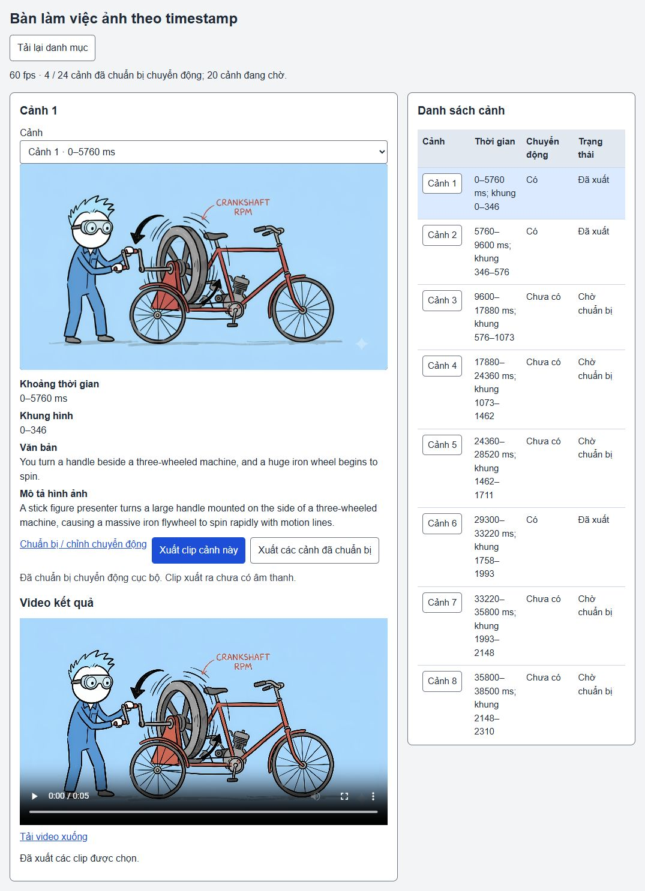

# Đề xuất chuyển động từ ảnh và kiểm tra UI

Bản kế tiếp c42de6d, nhánh codex/prehistoric-life. Tiến độ chức năng toàn dự án ước lượng **51%**; đây không phải tỷ lệ nghiệm thu hình hoặc final. Luồng đầy đủ còn active. Danh mục vẫn4/24 cảnh có chuyển động; chặng này không biến cảnh chưa đủ hỗ trợ thành clip giả hoàn thành.

## Đã triển khai

- CLI `scripts/image-motion-propose.ts`: importer đọc export và clock60fps; ảnh/narration/visual description gửi cho model đã chọn qua9router local. Mỗi ảnh có descriptor/source hash, preview vision, request reservation, receipt hoặc failure. Không ghi vào source export.
- Coder9router đề xuất schema strict và ánh xạ normalized0–1000 sang pixel. Orchestrator review rồi áp dụng. Target ID phải khớp moving region; không nhận code/path/URL tùy ý hoặc clean plate ID tự bịa. Vùng invalid/bounds/area/overlap chặn candidate. Text trong ảnh/cue được coi là dữ liệu.
- Model request có cap output token và call budget rõ; không auto-retry. Cache cùng source/clock/text/model/settings được kiểm tra trước network/preflight. Missing credentials hoặc hết budget trước call không reserve một request chưa gọi. CLI stops ở lỗi, giữ kết quả các cảnh trước.
- Cùng recipe1 hiện có, UI đã lưu/xem thử, Phát, tua Home, về catalog, xuất từ cache và tải file qua browser. File tải511180 bytes có SHA25697438753c9d0395dd926828b19504def4c810b9edd5602feae10e5d255e3cac8, giống MP4 đã QC của bản trước. Không rerender lại clip hợp lệ và không đổi recipe1.

## Vision thật và giới hạn

| Ảnh | Kết quả model | Hành động hiện tại |
|---|---|---|
|15 – các động cơ thời đầu |needs-artwork: flywheel cần bề mặt quay sạch| Không tự xoay cả pixel engine/background; scene vẫn needs-motion |
|18 – động cơ/khung/truyền động lắp chung |needs-artwork/pose: cần đưa động cơ vào khung và tiếp xúc; pivot đơn thuần không diễn tả được| Ưu tiên bổ sung tịnh tiến/lớp che và xem tiếp xúc; chưa hỏi người dùng tạo lại ảnh |
|15+18 chạy lại |0 call,2 receipt cache hit| Không tốn thêm lượt model ở client |

Hai response thật từ gpt-6-luna dùng2931+3019=5950 token. Coder schema3619 token; tester review4844 token. Tổng số liệu ghi nhận14413 token qua9router; không có call tạo ảnh mới. Runtime vision/happy path candidate→ảnh đẹp chưa được chứng minh bằng nguồn thật ở chặng này; candidate geometry/cache chỉ có unit proof. Hai kết quả cần hỗ trợ không phải nghiệm thu chất lượng model cho mọi ảnh.

Lỗi cấu hình đã tái hiện và sửa: CLI ban đầu đọc `MODEL_GATEWAY_URL=https://api.openai.com/v1` từ cấu hình chung thay vì9router; hai yêu cầu HTTP gửi nhầm địa chỉ và bị từ chối. Lượt coder ghi nhận401; lượt trước chỉ lưu code http, không lưu status/usage. Không tuyên bố số token/chi phí của hai lượt đó bằng0. Default CLI mới cố địnhNINE_ROUTER_URL20128, regression test đặt URL chung sang API khác vẫn xác nhận settings local. Hai call vision thật sau sửa thành công; cache re-run không gửi request. Các failure/request cũ giữ trong runtime để điều tra, không log key/header/provider body vào báo cáo.

Tester chỉ ra usage fallback có thể lấy response cũ của adapter khi lượt mới lỗi trước response. Regression tái hiện failure bị gán1000/999 token cũ; sau sửa chỉ ghi usage của response thuộc invocation hiện tại, test đã qua. Model review là static source, không thay runtime/image review. [Resolution](review-resolution.json).

## Bằng chứng và chạy lại

Các file test mới kiểm tra bounds/geometry/target IDs, hidden artwork, cache/source thay đổi, corruption, concurrent reservation, preflight, HTTP max_tokens/vision/usage và định tuyếnlocal. Runtime toàn sản phẩm chưa chạy; không dùng kết quả TEST-RESULTS V1 cho chặng này.

~~~powershell
node --import tsx --test tests/image-motion-proposal.test.ts tests/image-motion-proposal-gateway.test.ts
npm run build
~~~

CLI và cách vận hành/cap/resume xem [hướng dẫn tool](../../topics/IMAGE-TIMESTAMP-MOTION.md). Server riêng vẫn http://127.0.0.1:8860/. Cổng8850/8858 và source/projects khác giữ nguyên. [Runtime audit](runtime-audit.json), [proposal15](proposal-15.json), [proposal18](proposal-18.json), [UI smoke](ui-smoke.json).

## Còn thiếu

1. Renderer tịnh tiến/lắp ghép cho cue18, khả năng khác nếu câu chuyện đòi hỏi; asset clean texture/nền đúng phần bị che, bắt đầu cue15. Không ép các cảnh này thành mẫu gật đầu/quay không ăn nhập lời.
2. Candidate có vùng chính xác trên nguồn thật và được người dùng duyệt; chưa có nút đề xuất/import receipt trong Studio. UI tạo/vẽ vùng mới, upload và retry request gián đoạn còn cần kiểm chứng/tích hợp.
3.20 cảnh chưa có recipe;4 cảnh có clip vẫn chờ duyệt chất lượng hình/diễn xuất. Không báo full video đã đạt60fps hoặc narration hoàn thành.
4. Sau khi chuyển động từng ảnh đạt: ghép đúng clock/gaps/voice, review/repair/final/QC. Ba luồng input và ngoại ngữ/TTS ngoài/local còn trong mục tiêu chung; code narration đang dở giữ riêng.

Artifact/proposal luôn applied:false,productionReady:false,qualityAccepted:false. Không mark mục tiêu hoàn thành.

Snapshot source index`3e340820a0f709246a5c4b5d0400b53e50b69b77` đã build core/Studio/Vite, typecheck toàn test tracked và CLI mới, chạy42/42 test tập trung (0fail/0skip). Working checkout vẫn có native-support-gait-continuity chưa tracked với lỗi cũ; không đưa file đó vào commit hay báo toàn working checkout PASS. Chỉ bổ sung báo cáo/checks/hash sau xác minh; TS được đối chiếu byte với snapshot trước commit. [Checks](checks.json).
