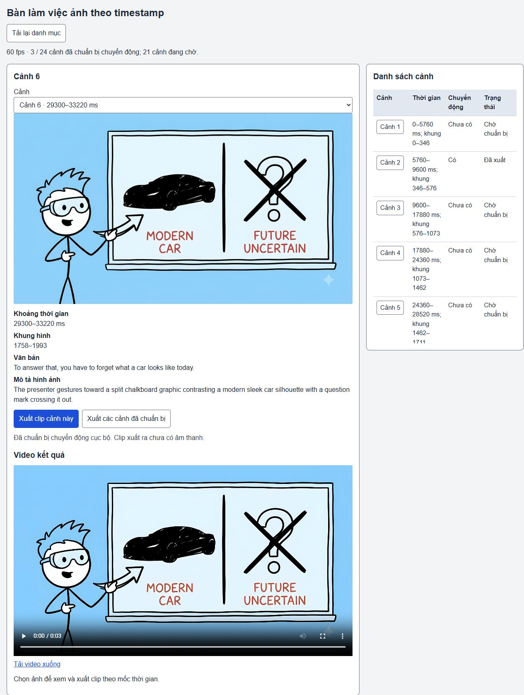

# Bàn làm việc ảnh + timestamp — 12/10/2026

Đã triển khai danh mục ảnh, worker xuất clip 60fps, xem trước/tải MP4, cache đã kiểm tra, trạng thái lượt xuất và khôi phục sau nạp trang/khởi động server. Đây là phần xử lý từng ảnh của tool; chưa nghiệm thu video đầy đủ hoặc chất lượng diễn xuất.

## Bằng chứng chạy thật

- Nguồn: export `flow_doodle/3bec044e0bb441d49c6277acd74ac763`, 24 cảnh, timeline 129260ms, hai gap được giữ. Source export chỉ được đọc.
- Server companion: `http://127.0.0.1:8860/`. Studio 8858 được giữ riêng.
- UI gọi worker thật cho 0006; một lượt nhóm thật xử lý 0002/0006/0013. Lượt sau khởi động lại dùng lại cả ba clip, không thêm thư mục attempt hay chạy renderer.
- Nhóm mới `ebb39f77-d138-415c-a233-6ac8378c2c0c`: done, completed 3/3. Nhóm dùng lại `2098906b-efb4-45bc-ac9b-107a0424f654`: done, completed 3/3. 21 cảnh chưa chuẩn bị vẫn hiển thị chờ.
- HTTP thật: busy 409, media revision cũ 409, MP4 range `bytes=0-127` trả 206 và đúng 128 byte.
- Nạp lại trang trong lượt đang chạy: tiếp tục theo dõi cùng ID, không dispatch worker thứ hai. Nạp lại server: clip có receipt hợp lệ hiện lại.
- Trình duyệt đọc video 0006: duration 3.916667s, readyState 4, không lỗi media, mặc định paused. Space phát video; link tải tạo MP4 thật trong Downloads.
- File MP4 tải từ UI có hash trùng clip trong cache. HTTP render revision cũ trả 409; chọn cảnh 0001 chưa có chuyển động trả 422.
- Probe giữa cảnh 0006: 114663 pixel thay đổi trong vùng đầu/tay được chọn; không đổi pixel ngoài vùng x=95–790, y=275–836. Frame đầu/cuối tái tạo ảnh gốc chính xác ở cấp RGBA. Điều này chứng minh chuyển động cục bộ và bảo toàn ảnh, không chứng minh diễn xuất tự nhiên.
- Layout 375/800/1280px: không tràn ngang, ảnh giữ 16:9 và toàn bộ vùng nguồn; điều khiển có thể dùng bàn phím. 375px ẩn cột chuyển động, giữ trạng thái và clock; thông tin chuyển động vẫn ở phần chi tiết. Không autoplay.

| Cảnh | Clock ms | Frame 60fps | Số frame | Chuyển động |
|---|---|---|---|---|
| 0002 | 5760–9600 | 346–576 | 230 | Bánh quay, không thêm chú thích |
| 0006 | 29300–33220 | 1758–1993 | 235 | Xoay nhẹ đầu và tay chỉ từ pixel ảnh gốc |
| 0013 | 57340–64840 | 3440–3890 | 450 | Các bánh răng từ layer cũ |

0006 dùng matte thủ công và clean plate cho vùng chồng mép bảng. Tay là một bộ phận raster xoay nhẹ quanh vai; không phải pose mới, head turn 3D hay lip-sync. Bản v2 kéo theo viền bảng; v3 còn bóng viền; v4 đã thu nhỏ phần foreground và phục hồi toàn vùng xóa. Kiểm tra mắt thường còn thấy chi tiết ở vai/mép bảng cần artist/người dùng duyệt; không đánh dấu qualityAccepted.

## Kiểm tra code và phân công

22 test liên quan pass; build core + typecheck Studio + Vite pass. Typecheck riêng cho script Studio/source-part và test API mới pass. Bộ test protocol có worker fixture cố tình lỗi để kiểm tra stale/busy/missing-motion/reload/tamper/lease; fixture không được dùng làm bằng chứng video runtime.

9router: `coder` giao UI (10053 token), `tester` review source (11064 token). Tổng hai lượt 21117 token, không gọi image/TTS trả phí. Đề xuất được đọc và chỉnh trước khi áp dụng. Reviewer phát hiện nguy cơ PID được tái sử dụng; đã bổ sung process-start identity và ca hồi quy. Reviewer không chạy test runtime.

Log và artifact local: `runtime/image-motion/timestamp-workbench/`. Receipt/video có hash, frame/decode/seek và cờ `productionReady:false`, `qualityAccepted:false`. [SOURCE-HASHES.json](SOURCE-HASHES.json) pin source giao trong commit; không pin các thay đổi narration đang dở hoặc file của người khác.

## Phần chưa nghiệm thu

- 21 ảnh còn lại chưa có recipe; chưa tự động tách phần/nền phức tạp cho mọi PNG/JPG.
- Chất lượng hành động tự nhiên, khớp/tiếp xúc và toàn bộ mặt ở các hướng khác chưa được người dùng duyệt.
- Ghép toàn bộ timeline + audio/SRT, nội dung ba luồng, giọng EN/VI/JA/KO/local, review/repair/final/QC và các điều kiện mục tiêu chung vẫn còn phải hoàn thành.
- Lỗi typecheck toàn bộ tests đã có trước: hai TS18048 trong file untracked `tests/native-support-gait-continuity.test.ts:13`. Không coi build pass là toàn repo đã nghiệm thu.

Tiến độ triển khai ước lượng sau commit này: **47%** toàn dự án (lần trước 46%). Đây là ước lượng chức năng, không phải phần trăm chất lượng hình ảnh hoặc nghiệm thu.
